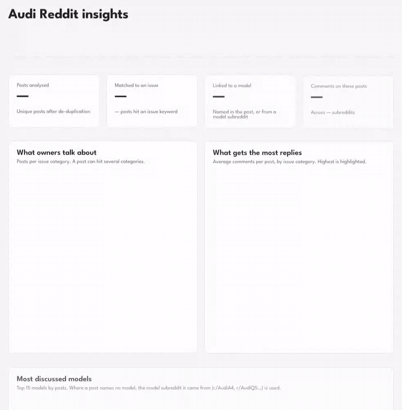
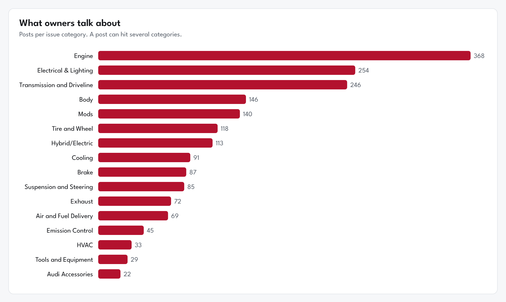
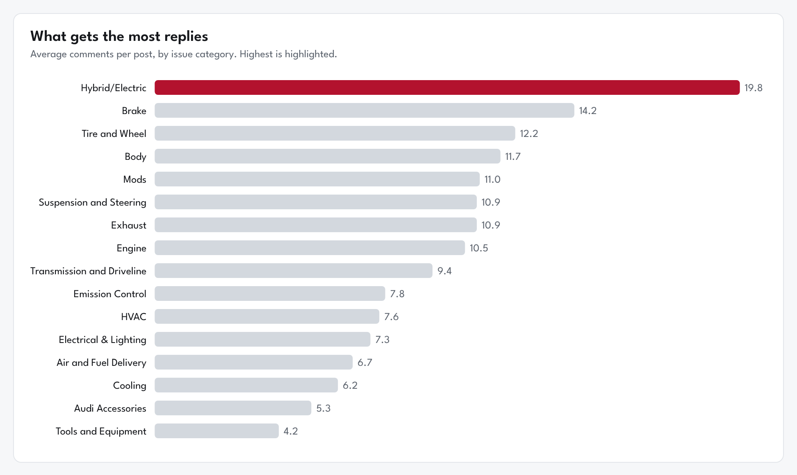
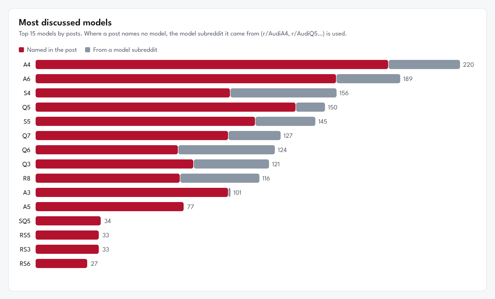
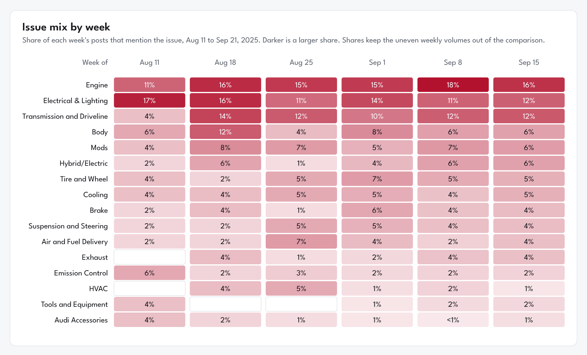
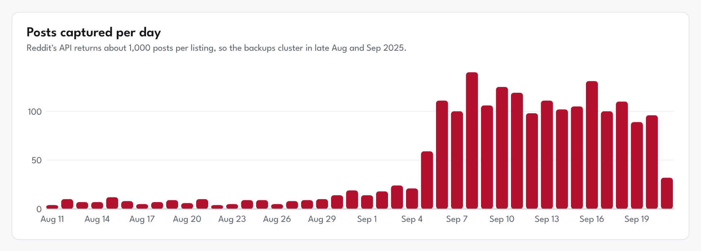
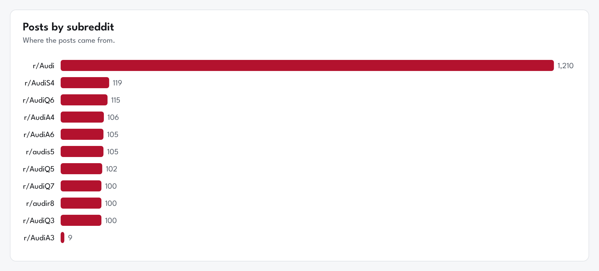

# Reddit Audi Pipeline

<a href="https://themanbuildingpipelines.github.io/reddit-audi-pipeline/">
  
</a>

**[Open the interactive dashboard →](https://themanbuildingpipelines.github.io/reddit-audi-pipeline/)**
Every chart below links to its live version, where you can hover for exact numbers and search the most discussed posts.

## Why this project

I've been an Audi fan for years and I spend a lot of time in the Audi subreddits. Owners there post about everything: a misfire on the highway, a new set of wheels, an S4 they just bought at auction. I wanted to turn that noise into answers. What do Audi owners actually struggle with? Which models get talked about most? And which conversations pull people in?

So I built a pipeline that pulls posts from r/Audi and nine model subreddits, cleans them in layers and sorts each post into the part of the car it's about.

## Data Architecture

There are six layers in my architecture:

1. **Bronze Landing** - This layer consists of two files. A JSON file that is uploaded to Azure Blob storage (however, it is limited). And, a CSV file that has data spanning across several months that acts as my source of truth.
 
3. **Bronze Raw** - The JSON file from the Landing Layer is transformed to CSV in this section and uploaded to Azure SQL through ADF.

5. **Silver Base** - The now converted (but limited CSV file) is joined with the source of truth (from the landing area) to make it more meaningful for analysis, which comes later. While at it, I remove duplicates from the now joined tables and store them in my Silver schema.

7. **Silver Enriched** - Here, more data cleaning is done, dropping unwanted columns, categorizing text data, converting BIGINT to datetime where necessary, and renaming columns.

9. **Gold Curated** - Since this dataset isn't transactional, I thought there's no need to classify the tables here as facts or dims. However, I have two tables. Categorized and uncategorized. The categorized consist of text data that has been categorized, think of engine issues, HVAC, brake issues, suspension issues. The latter is uncategorized, with customer sentiments not easily understood, so machine analysis might need to take place here to make sense of the issues. I'll probably handle this in the future when I get my hands dirty with machine learning.

## What I found

2,171 unique posts and 26,486 comments, mostly from August and September 2025.

### 1. Engine talk never goes away

<a href="https://themanbuildingpipelines.github.io/reddit-audi-pipeline/#issues"></a>

Engine problems lead with 368 posts. Electrical and lighting comes second (254) and the transmission comes third (246). The weekly view further down shows engine posts holding at 11% to 18% of every single week. It's the background hum of owning an Audi.

**Why it matters:** a service shop or parts seller can plan around engine and electrical work all year rather than chasing seasonal spikes.

### 2. The loudest topic isn't the most common one

<a href="https://themanbuildingpipelines.github.io/reddit-audi-pipeline/#engagement"></a>

Hybrid and electric posts are only the seventh most common category. They draw the most replies though, at 19.8 comments per post on average. That holds on the median too (7 comments, the highest of any category), so it isn't one viral thread doing the work. The biggest of these were news threads about the RS6 and RS3 being cancelled or discontinued. Owners have strong feelings about where Audi is heading.

**A correction to my first version:** I originally reported HVAC as the most engaging issue. That was a bug. My keyword match looked for "ac" anywhere in the text, so every post containing words like "back" or "track" counted as an air conditioning post. Once keywords had to match whole words, HVAC dropped to 33 posts with an unremarkable 7.6 comments per post. Checking your own pipeline matters as much as building it.

### 3. Everyday cars bring questions, performance cars bring conversations

<a href="https://themanbuildingpipelines.github.io/reddit-audi-pipeline/#models"></a>

The A4 (220 posts) and A6 (189) are discussed more than any other model. They also get some of the fewest replies per post, around 5.5 and 3.8. Most of those posts are quick questions that get a quick answer. The RS cars flip that. RS7 posts average 108 comments, the RS3 averages 44 and the RS6 averages 36. Far fewer posts, far more energy.

The grey part of each bar is posts that didn't name a model but came from that model's own subreddit, so I counted them toward it.

**Why it matters:** volume tells you where the support load is. Replies tell you where the enthusiasm is. Marketing should treat those as two different audiences.

### 4. Electric talk is a small but steady slice

<a href="https://themanbuildingpipelines.github.io/reddit-audi-pipeline/#mix"></a>

I use share of posts each week here instead of raw counts, because the number of posts collected per week varies a lot (see the caveat below). The August weeks are small (50 to 74 posts each), so their shares jump around. Once September brought hundreds of posts a week, the mix settled: engine at 15% to 18%, electrical and transmission between 10% and 14%, hybrid and electric at 4% to 6%. Six weeks is too short to call anything a trend, which is exactly why I want more history in here.

### 5. The biggest threads aren't problems at all

The most commented post in the dataset (990 comments) is someone who bought a wrecked RS7 at auction and asked how to rebuild it. Posts like that don't match any issue keyword. About 44% of posts are like this, and they average 14.6 comments compared with 12.2 across everything. Keyword rules can't read stories, opinions or memes. That's the clearest case for the next step, which is a proper text model.

### A caveat about the data

<a href="https://themanbuildingpipelines.github.io/reddit-audi-pipeline/#daily"></a>

Reddit's API returns roughly 1,000 posts per listing, so each pull mostly captures the last few weeks. That's why the data clusters in September 2025. Treat everything here as a snapshot of that window, not a multi-year history.

<a href="https://themanbuildingpipelines.github.io/reddit-audi-pipeline/#subs"></a>

## Rebuilding it without Azure

The first version ran on Azure. An Azure Function pulled posts monthly into Blob Storage, Data Factory loaded them into Azure SQL, and stored procedures moved them through the layers above. When that subscription ended I rebuilt the same flow locally in Python and DuckDB from my backup CSVs, keeping the same bronze, silver and gold layers. The original Azure scripts are still in this repo for reference.

### What I fixed along the way

- **Categories with commas were split apart.** "Electrical, Lighting, Telematics" was being counted as three separate issues in every gold view. Categories are now joined with a pipe character and renamed.
- **Keywords matched inside other words.** "ac" matched "back" and "track". Keywords now have to match whole words.
- **Models were tagged by list order, not by what the post said first.** A post about the RS3 could be tagged as an e-tron because "e-tron" appeared later in the text. Now the first model mentioned wins.
- **Duplicates were dropped arbitrarily.** When the same post appears in several pulls, the copy with the most comments is kept, since it's usually the most recent.

## Run it yourself

```bash
pip install duckdb pandas
python scripts/local/pipeline.py path/to/raw_csvs out
```

The raw CSVs are the Reddit API exports (columns `id`, `subreddit`, `title`, `selftext`, `author`, `created_utc`, `score`, `num_comments` and so on). The script writes a DuckDB database to `out/audi.duckdb` with `bronze`, `silver` and `gold` schemas, and exports the gold tables to `out/gold/*.csv`.

## Repo layout

```
azure-functions/         Original Reddit extraction function (Azure)
scripts/Bronze/          Original Azure SQL bronze scripts
scripts/Silver/          Original silver scripts
scripts/gold/            Original gold views
scripts/local/           Local rebuild: the whole pipeline in one script (DuckDB)
tests/                   Silver data quality checks
docs/index.html          Interactive dashboard (served by GitHub Pages)
docs/images/             Chart images used in this README
```

## What's next

- Add my full master backup, which should reach further back, so the weekly view can become a real trend.
- Replace keyword rules with a text classifier so the 44% of uncategorised posts can be sorted.
- Bring back scheduled pulls so the dataset grows every month instead of being a snapshot.
